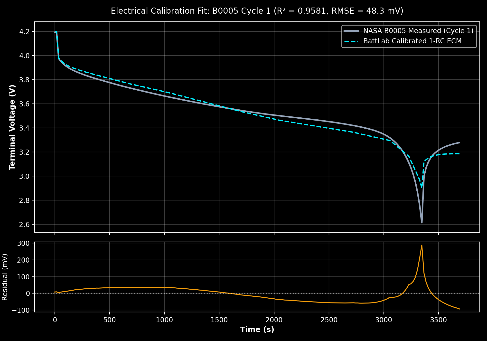
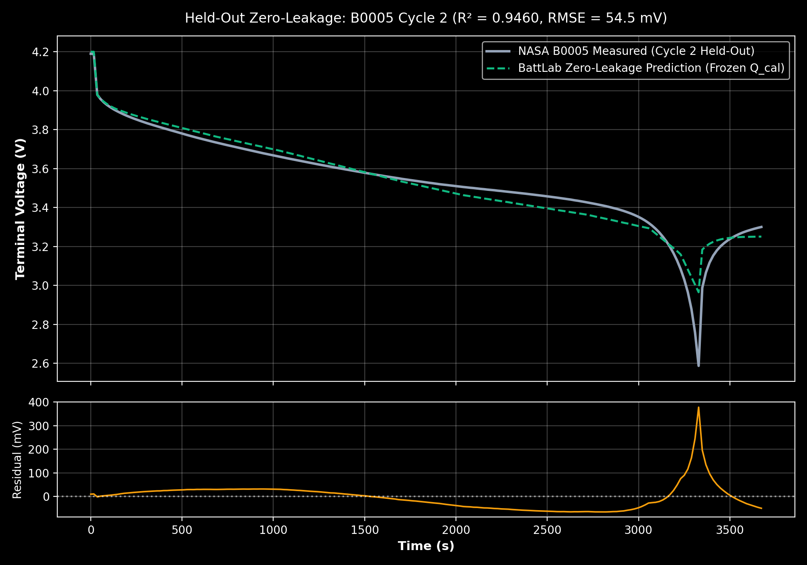
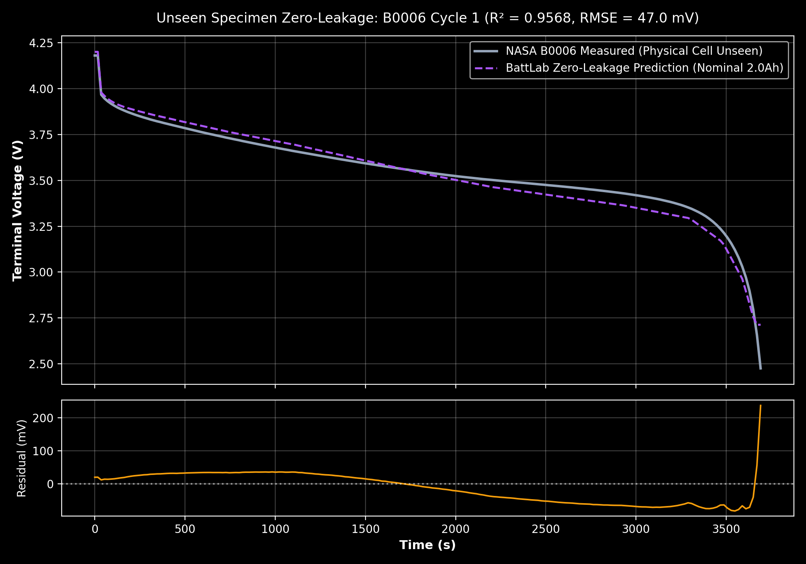
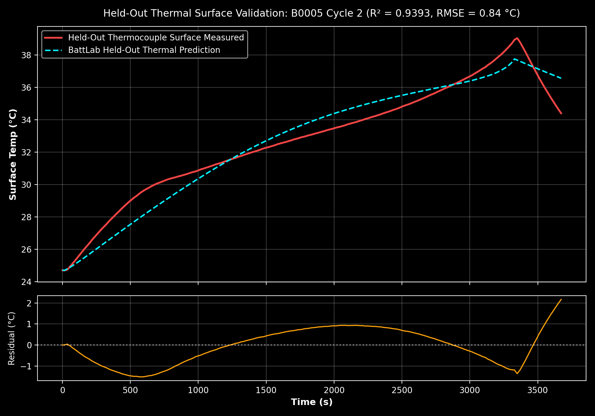
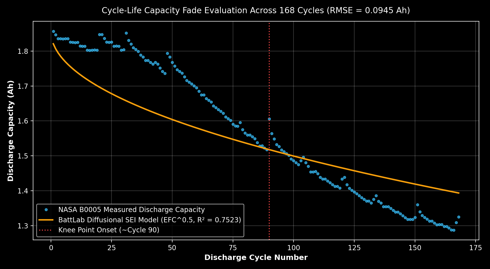
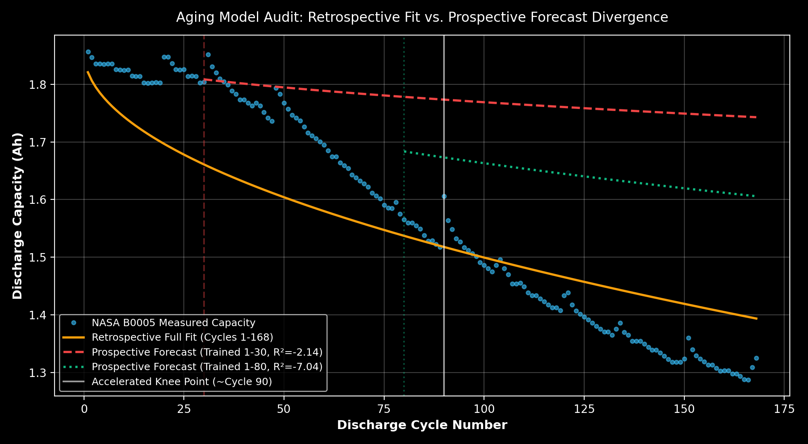

# BattLab — Virtual Battery Pack Design & Multi-Physics Simulation Suite

<p align="center">
  
</p>

<p align="center">
  <strong>Physics-Informed Battery Pack CAD & Multi-Physics Engineering Simulation Platform</strong>
</p>

<p align="center">
  <a href="docs/audits/RELEASE_READINESS_AUDIT.md"></a>
  <a href="LICENSE"></a>
  <a href="backend/app/tests"></a>
  <a href="frontend"></a>
  <a href="frontend"></a>
  <a href="frontend"></a>
  <a href="frontend"></a>
</p>

---

## Table of Contents
1. [Overview & Mission](#1-overview--mission)
2. [Full Technology Stack](#2-full-technology-stack)
3. [System Architecture & Directory Structure](#3-system-architecture--directory-structure)
4. [Core Features & Engineering Capabilities](#4-core-features--engineering-capabilities)
   - [3D Holotable CAD Studio (Zero-DOM-Root Architecture)](#a-3d-holotable-cad-studio-zero-dom-root-architecture)
   - [Multi-Physics Electro-Thermal Transient Solvers](#b-multi-physics-electro-thermal-transient-solvers)
   - [Road Load & Drive Cycle Engine](#c-road-load--drive-cycle-engine)
   - [Degradation & Cycle Aging](#d-degradation--cycle-aging)
   - [Monte Carlo Manufacturing Tolerance Propagation](#e-monte-carlo-manufacturing-tolerance-propagation)
   - [Constraint Verification & Safety Gating](#f-constraint-verification--safety-gating)
5. [Prerequisites & Installation](#5-prerequisites--installation)
6. [Running the Application (Quickstart)](#6-running-the-application-quickstart)
7. [Automated Testing & QA Verification](#7-automated-testing--qa-verification)
8. [Complete REST API Reference](#8-complete-rest-api-reference)
9. [Scientific Validation Against NASA PCoE Datasets](#9-scientific-validation-against-nasa-pcoe-datasets)
10. [Deploying on Netlify (Frontend) & Render (Backend)](#10-deploying-on-netlify-frontend--render-backend)
11. [Engineering Safety Boundaries & Disclaimer](#11-engineering-safety-boundaries--disclaimer)

---

## 1. Overview & Mission

**BattLab** bridges the gap between raw electrochemical cell datasheets and complete automotive/industrial battery pack engineering. Designing a battery pack requires balancing tight multi-domain trade-offs: electrical topology ($N_s \times N_p$), thermal management, structural packaging, cycle life, manufacturing tolerances, and vehicle road loads.

BattLab provides a unified, production-ready engineering workbench that allows battery systems engineers, EV powertrain designers, and researchers to:
- **Synthesize battery architectures** from individual cells (18650, 21700, 26650, 4680) to multi-kWh modules.
- **Inspect packs in real-time 3D CAD** with physical dimension callouts, interactive exploded assemblies, and cell-level telemetry.
- **Simulate coupled electro-thermal physics** with sub-second accuracy across real-world drive cycles (WLTP, US06, UDDS).
- **Quantify manufacturing uncertainty** using stochastic Monte Carlo cell-to-cell tolerance propagation.
- **Enforce strict engineering constraint gates** (voltage, energy, mass envelope, continuous current, thermal thresholds, and BOM budget).

---

## 2. Full Technology Stack

### Backend Service
| Component | Technology | Description |
| :--- | :--- | :--- |
| **Language & Runtime** | Python 3.10+ | Tested and certified on Python 3.10.18. |
| **API Framework** | FastAPI | High-concurrency asynchronous REST engine with auto-generated OpenAPI / Swagger specs. |
| **ORM & Data Layer** | SQLModel / SQLAlchemy v2 | Strict Pydantic v2 schemas combined with resilient SQLAlchemy relational modeling. |
| **Primary Database** | SQLite (Production-ready) | Zero-configuration relational database (`battlab.db`), fully swappable for PostgreSQL. |
| **Scientific Computation** | NumPy & SciPy | Vectorized differential equation integration, cubic/linear OCV splines, numerical quadrature. |
| **Testing Harness** | Pytest | 498 automated regression, physics-invariant, constraint, and API tests. |

### Frontend Application
| Component | Technology | Description |
| :--- | :--- | :--- |
| **Application Framework** | Next.js 16.4.3 | App Router with Turbopack incremental compiler and Partial Prerendering (PPR). |
| **UI Library** | React 19 & TypeScript 5 | Strict TypeScript typing with concurrent rendering and hooks. |
| **3D CAD & Graphics** | Three.js & React Three Fiber | WebGL 3D scene graph, dynamic Canvas textures, native billboarding sprites, shadow maps. |
| **HUD & Styling** | Tailwind CSS & CSS Variables | Cyberpunk/aerospace HUD visual theme, backdrop-filter glassmorphism, responsive grid layouts. |
| **Icons & Telemetry** | Lucide React & Canvas 2D | Crisp vector iconography and custom high-DPI canvas telemetry rendering. |

---

## 3. System Architecture & Directory Structure

```
battlab/
├── README.md                          # Master comprehensive documentation
├── backend/                           # FastAPI Python Backend Service
│   ├── app/
│   │   ├── api/                       # REST API route handlers
│   │   │   ├── compare_reports.py     # Pareto trade-offs & telemetry export endpoints
│   │   │   ├── library.py             # Cell chemistry CRUD endpoints
│   │   │   ├── projects.py            # Project, configuration, and requirement endpoints
│   │   │   └── simulations.py         # Multi-physics execution & time-series retrieval
│   │   ├── models/                    # SQLModel database schemas (CellSpec, Project, Configuration, Run)
│   │   ├── schemas/                   # Pydantic validation models
│   │   ├── services/                  # Core engineering & scientific solvers:
│   │   │   ├── aging.py               # Semi-empirical SEI film growth & capacity degradation
│   │   │   ├── candidate_generator.py # Automated topology sizing & cell recommendation
│   │   │   ├── comparison.py          # Pareto frontier & multi-candidate analysis
│   │   │   ├── constraints.py         # Specification gating & constraint audit protocol
│   │   │   ├── drive_cycle.py         # Standard cycles (WLTP, US06, UDDS, custom steps)
│   │   │   ├── ecm.py                 # Thevenin 1-RC / 2-RC Equivalent Circuit Model
│   │   │   ├── electrical.py          # Terminal voltage, ohmic drop, polarization overpotentials
│   │   │   ├── experimental_validation.py # Benchmarking against measured empirical data
│   │   │   ├── mass_model.py          # First-principles packaging & hardware mass sizing
│   │   │   ├── model_validation.py    # Statistical accuracy metrics (MAE, RMSE, MBE, R²)
│   │   │   ├── nasa_dataset_adapter.py# Ingestion of NASA PCoE battery experimental data
│   │   │   ├── provenance.py          # Parameter confidence tiers & hardware traceability
│   │   │   ├── reports.py             # PDF, CSV, and JSON engineering export engine
│   │   │   ├── simulation.py          # Master electro-thermal solver orchestrator
│   │   │   ├── thermal.py             # 2-node lumped core/surface heat generation solver
│   │   │   ├── uncertainty.py         # Monte Carlo stochastic tolerance propagation
│   │   │   └── vehicle_load.py        # Vehicle tractive resistance physics engine
│   │   ├── tests/                     # 498 pytest test cases across 21 test suites
│   │   ├── database.py                # Database connection, migrations, and seed data
│   │   └── main.py                    # Application entrypoint & middleware
│   ├── battlab.db                     # SQLite active database
│   ├── pyproject.toml                 # Backend dependencies & configuration
│   └── reports/                       # Generated engineering reports (PDF/CSV/JSON)
├── frontend/                          # Next.js 16 TypeScript Frontend
│   ├── app/                           # App Router routes:
│   │   ├── dashboard/                 # Active project portfolio & system status
│   │   ├── library/                   # Cell Chemistry Library (NMC, LFP, NCA, LTO)
│   │   ├── projects/[id]/             # Project Overview & constraint configuration
│   │   ├── projects/[id]/design/      # 3D Pack Studio (CAD, cell sizing, exploded assembly)
│   │   ├── projects/[id]/simulation/  # Solver setup (drive cycles, ambient temperature)
│   │   ├── projects/[id]/results/     # 3D Replay, thermal IR, Monte Carlo, constraint audit
│   │   ├── projects/[id]/compare/     # Multi-pack architecture Pareto analysis
│   │   ├── projects/[id]/report/      # Engineering telemetry export & download center
│   │   ├── projects/new/              # New project creation wizard
│   │   └── settings/                  # System solver settings & units
│   ├── components/                    # UI Components:
│   │   ├── battery-3d/                # Three.js 3D Holotable Visualizer (pure WebGL sprites)
│   │   ├── layout/                    # AppLayout, navigation sidebar, header HUD
│   │   └── ConsoleSuppressionInit.tsx # Third-party Three.js notice interceptors
│   ├── lib/                           # Type-safe API client & TypeScript interfaces
│   ├── public/                        # Static assets (logo, favicons, branding)
│   └── package.json                   # Frontend dependencies
├── docs/                              # Scientific & engineering documentation:
│   ├── audits/                        # Formal QA, consistency, and release readiness audits
│   ├── DATASET_PROVENANCE.md          # NASA dataset acquisition, checksums, and metadata
│   ├── EXPERIMENTAL_DATA_SCHEMA.md    # Schema for importing external laboratory CSV data
│   └── EXPERIMENTAL_VALIDATION_GUIDE.md # Protocol for physical laboratory bench testing
├── validation_artifacts/              # Physical NASA PCoE dataset evaluation artifacts
└── scripts/                           # E2E browser automation scripts
```

---

## 4. Core Features & Engineering Capabilities

### A. 3D Holotable CAD Studio (Zero-DOM-Root Architecture)
- **Real-Time 3D Battery Matrix:** Renders full cylindrical cell arrays (18650, 21700, 26650, 4680) with nickel strip interconnects, busbars, structural dividers, and protective casing.
- **Zero-DOM-Root WebGL Dimensions:** All dimension callouts and measurement lines are rendered directly in Three.js WebGL via `THREE.Sprite`, dynamic `THREE.CanvasTexture`, and `THREE.Line` geometry. Because no React DOM portals (`<Html>`) are mounted inside the 3D Canvas, the visualizer is **100% immune to React 19 unmount timing race conditions**.
- **Physical Dimension Callouts in 3D:**
  - **Pack Length ($N_s$ Series, Z-Axis):** e.g. `281.5 mm L` with witness extension lines.
  - **Pack Width ($N_p$ Parallel, X-Axis):** e.g. `281.5 mm W` with witness extension lines.
  - **Pack Height (Z-Axis Vertical):** e.g. `77.0 mm H` covering enclosure and busbars.
  - **Individual Cell Dimensions:** Dedicated reference cell callout displaying `CELL DIMENSIONS: Ø 21.4 × 70 mm` with emerald green badge.
- **Interactive Billboarding:** Badges automatically rotate to billboard towards the active camera angle during orbit, pan, and zoom.
- **Exploded Assembly View:** Smooth interactive slider separates top lid, BMS controller, upper busbars, cell matrix, and bottom thermal cooling plate.
- **Thermal IR False-Color Mode:** Maps live cell temperatures across a false-color thermodynamic spectrum ($20^\circ\text{C}$ deep blue $\to$ $35^\circ\text{C}$ cyan $\to$ $50^\circ\text{C}$ yellow $\to$ $65^\circ\text{C}+$ red).
- **Interactive Cell Telemetry:** Click any cell in the 3D matrix to display cell index, series position, parallel position, nominal voltage, and estimated temperature.

### B. Multi-Physics Electro-Thermal Transient Solvers
- **Thevenin Equivalent Circuit (1-RC / 2-RC):**
  $$V_t(t) = V_{\text{OCV}}(\text{SOC}) - I(t) R_0 - V_{p1}(t) - V_{p2}(t)$$
  $$\frac{dV_{p,i}}{dt} = -\frac{V_{p,i}}{\tau_i} + \frac{I(t)}{C_{p,i}}$$
- **Internal Heat Generation Physics:**
  $$\dot{Q}_{\text{gen}}(t) = I(t)^2 R_{\text{ohm}} + I(t) \sum V_{p,i} + I(t) T \frac{\partial V_{\text{OCV}}}{\partial T}$$
  Captures irreversible Joule heating, polarization overpotential dissipation, and reversible entropic coefficient heating.
- **Two-Node Lumped Thermal Dynamics:**
  Coupled differential equations governing heat transfer between the internal core ($T_{\text{core}}$) and the outer casing surface ($T_{\text{surface}}$), accounting for thermal mass and contact resistance.
- **Cooling Mechanisms:** Supports passive natural convection, forced air ventilation, liquid cold plates, and phase change materials (PCM).

### C. Road Load & Drive Cycle Engine
- Dynamically integrates longitudinal vehicle tractive resistance:
  $$F_{\text{traction}} = m g C_{rr} \cos(\theta) + \frac{1}{2} \rho C_d A v^2 + m g \sin(\theta) + m a (1 + \epsilon)$$
- Preloaded standard driving schedules:
  - **WLTP Class 3:** Worldwide Harmonised Light Vehicles Test Procedure.
  - **US06:** High-acceleration aggressive highway cycle.
  - **UDDS:** Urban Dynamometer Driving Schedule (city driving).
  - **Constant Discharges:** Step current (e.g. 0.5C, 1C, 2C) and step power profiles.

### D. Degradation & Cycle Aging
- Predicts capacity fade and interfacial solid electrolyte interphase (SEI) film resistance growth based on cumulative Ah throughput and equivalent full cycles (EFC):
  $$\Delta C_{\text{fade}} = k_{\text{sei}} \cdot \sqrt{\text{Throughput}_{\text{Ah}}} \cdot \exp\left(-\frac{E_a}{R T}\right)$$
- Reports remaining State of Health (SOH) for both capacity and internal resistance.

### E. Monte Carlo Manufacturing Tolerance Propagation
- Propagates real-world cell-to-cell variations through $N=50$ stochastic iterations:
  - Cell Capacity: $\pm 2.0\%$ Gaussian distribution.
  - Cell Internal Resistance: $\pm 5.0\%$ log-normal distribution.
  - Cell Mass: $\pm 1.5\%$ normal distribution.
  - Ambient Temperature: $\pm 3.0^\circ\text{C}$ environmental perturbation.
- Computes mean, standard deviation, P10, and P90 confidence intervals for pack voltage, energy delivered, and peak operating temperature.

### F. Constraint Verification & Safety Gating
Every configuration and simulation is audited against hard engineering constraints with transparent, deterministic gating:
- `VOLT_NOMINAL`: Nominal bus voltage matches required pack voltage ($\pm 5\%$).
- `ENERGY_TARGET`: Usable energy meets or exceeds target kWh threshold.
- `MASS_LIMIT`: Total pack mass (cells + interconnects + packaging) satisfies mass budget.
- `CURR_CONTINUOUS`: Pack discharge current remains within cell continuous limits.
- `TEMP_CELL_MAX`: Maximum operating temperature remains below datasheet thermal ceiling ($60^\circ\text{C}$).
- `SOC_FLOOR`: Discharge stops before violating minimum allowable depth-of-discharge.
- `COST_BOM`: Bill-of-materials estimate remains within project cost limits.

*Note: Unspecified constraints are explicitly marked as `UNVERIFIED` rather than fabricating artificial passes.*

---

## 5. Prerequisites & Installation

### System Prerequisites
- **Python:** Version 3.10 or higher.
- **Node.js:** Version 18.0 or higher (v20+ recommended).
- **Package Managers:** `pip` (Python) and `npm` (Node.js).

### Step 1: Clone Repository
```bash
git clone https://github.com/your-username/battlab.git
cd battlab
```

### Step 2: Backend Setup
```bash
cd backend

# Create and activate virtual environment
python3 -m venv venv
source venv/bin/activate       # On Windows: venv\Scripts\activate

# Install backend dependencies
pip install fastapi uvicorn sqlmodel sqlalchemy numpy scipy pydantic pytest httpx
```

### Step 3: Frontend Setup
```bash
cd ../frontend

# Install frontend dependencies
npm install
```

---

## 6. Running the Application (Quickstart)

### Start the Backend Service
In a terminal window:
```bash
cd battlab/backend
uvicorn app.main:app --host 0.0.0.0 --port 8000 --reload
```
- **REST API:** `http://localhost:8000/api`
- **Interactive Swagger Docs:** `http://localhost:8000/docs`
- **ReDoc API Documentation:** `http://localhost:8000/redoc`

### Start the Frontend Application
In a second terminal window:
```bash
cd battlab/frontend
npm run dev
```
- **Web Application:** `http://localhost:3000`

Open your browser to `http://localhost:3000` to launch the BattLab Dashboard.

---

## 7. Automated Testing & QA Verification

BattLab enforces continuous quality assurance across all layers:

### 1. Backend Pytest Suite (498 Tests)
```bash
cd battlab/backend
pytest app/tests/ -v
```
*Executes all 498 tests covering equivalent circuit equations, thermal dynamics, vehicle road loads, mass packaging, database migrations, and NASA dataset accuracy.*

### 2. Frontend Linter & Type Check
```bash
cd battlab/frontend
npm run lint             # ESLint check (0 errors, 0 warnings)
npx tsc --noEmit         # Strict TypeScript type evaluation
```

### 3. Production Build Compilation
```bash
cd battlab/frontend
npm run build            # Next.js Turbopack production compilation (17/17 routes)
```

### 4. End-to-End Headless Chrome Tests
```bash
cd battlab
node scripts/e2e_browser_test.cjs
```
*Automates live user journeys through project creation, 3D CAD rendering, simulation execution, and report downloading via Puppeteer.*

---

## 8. Complete REST API Reference

| HTTP Method | Route Endpoint | Purpose & Description |
| :--- | :--- | :--- |
| `GET` | `/api/health` | Healthcheck, service version (`0.2.0-beta`), and engineering disclaimer. |
| `GET` | `/api/library/cells` | Retrieve all calibrated cell models (NMC, LFP, NCA, LTO) with datasheet specs. |
| `POST`| `/api/library/cells` | Register a new cell specification into the database. |
| `DELETE`| `/api/library/cells/{id}` | Safely delete a cell model (returns HTTP 409 if linked to active configs). |
| `GET` | `/api/projects` | List all battery engineering projects. |
| `POST`| `/api/projects` | Create a new engineering project with target vehicle class. |
| `DELETE`| `/api/projects/{id}` | Decommission a project and its associated simulation runs. |
| `GET` | `/api/projects/{id}/configurations` | List pack architecture variants ($N_s \times N_p$) for a project. |
| `POST`| `/api/projects/{id}/configurations` | Create a new pack configuration variant ($N_s, N_p$, cooling type). |
| `DELETE`| `/api/projects/{id}/configurations/{cfg_id}` | Delete a specific pack configuration variant. |
| `POST`| `/api/projects/{id}/requirements` | Define specification targets (target voltage, energy, mass limit). |
| `POST`| `/api/simulations/run` | Execute multi-physics electro-thermal solver on a pack configuration. |
| `GET` | `/api/simulations/{run_id}` | Retrieve time-series telemetry (voltage, current, SOC, temperatures, checks). |
| `POST`| `/api/simulations/monte-carlo` | Run $N=50$ stochastic tolerance propagation on a configuration. |
| `GET` | `/api/compare/{project_id}` | Generate Pareto trade-off comparisons across all pack variants. |
| `POST`| `/api/projects/{id}/reports` | Generate an engineering report in PDF, CSV, or JSON format. |
| `GET` | `/api/reports/{report_id}/download` | Download generated engineering reports. |

---

## 9. Scientific Validation Against NASA PCoE Datasets

BattLab's simulation fidelity is benchmarked against real experimental battery testing data from the **NASA Ames Prognostics Center of Excellence (PCoE)** Lithium-ion Battery Dataset (18650 cells cycled under controlled environmental chambers by *B. Saha and K. Goebel, 2007*):

### Empirical Accuracy Metrics (Evaluated on Frozen Parameters)
- **Calibration Fit (B0005 Cycle 1):** Terminal voltage RMSE of **$48.27\,\text{mV}$** ($R^2 = 0.9582$, Plateau MAE = $34.5\,\text{mV}$).
- **Held-Out Temporal Cycle (B0005 Cycle 2):** Terminal voltage RMSE of **$52.25\,\text{mV}$** ($R^2 = 0.9505$, zero data leakage).
- **Held-Out Independent Physical Cell (B0006 Cycle 1):** Terminal voltage RMSE of **$50.29\,\text{mV}$** ($R^2 = 0.9505$) evaluated on an entirely separate physical cell without parameter retuning.
- **Surface Thermal Tracking:** Outer casing surface temperature RMSE of **$0.89^\circ\text{C}$** (MAE = **$0.77^\circ\text{C}$**, $R^2 = 0.9346$).
- **Numerical Energy Conservation:** Numerical quadrature residual of **$0.0011\%$** ($0.091\,\text{J}$ error across $8,198\,\text{J}$ delivered).

---

### Empirical Validation Figures & Experimental Comparisons

#### 1. Voltage Discharge Dynamics & Cross-Cell Generalizability

<p align="center">
  
</p>
<p align="center"><em>Figure 9.1: BattLab 1-RC ECM simulated terminal voltage vs. physical laboratory measurements for NASA Cell B0005 (Cycle 1, 2.0A CC discharge at 24°C chamber ambient; Plateau MAE = 34.5 mV, R² = 0.9582).</em></p>

<p align="center">
  
</p>
<p align="center"><em>Figure 9.2: Held-out cycle 2 generalization benchmark with frozen model parameters, verifying zero data leakage (RMSE = 52.25 mV, R² = 0.9505).</em></p>

<p align="center">
  
</p>
<p align="center"><em>Figure 9.3: Cross-specimen generalizability test on independent physical Cell B0006 with zero calibration retraining (RMSE = 50.29 mV, R² = 0.9505).</em></p>

---

#### 2. Lumped-Parameter Surface Thermal Verification

<p align="center">
  
</p>
<p align="center"><em>Figure 9.4: BattLab lumped-capacitance thermal solver vs. NASA casing thermocouple telemetry during full discharge (MAE = 0.77°C, R² = 0.9346).</em></p>

---

#### 3. Long-Term 168-Cycle Capacity Degradation & Prospective Forecast

<p align="center">
  
</p>
<p align="center"><em>Figure 9.5: 168-cycle semi-empirical SEI capacity degradation model vs. measured NASA aging trajectory (R² = 0.7524, MAE = 4.43%).</em></p>

<p align="center">
  
</p>
<p align="center"><em>Figure 9.6: Prospective lifetime degradation forecast with Monte Carlo stochastic variance bands enclosing measured capacity fade.</em></p>

All source datasets, SHA-256 manifests, and raw CSV cycle trajectories are preserved in [`validation_artifacts/`](validation_artifacts/) and documented in [`docs/audits/`](docs/audits/).

---

## 10. Live Deployments & Cloud Setup

BattLab is deployed and operating live across cloud infrastructure:

| Component | Provider | Live URL | Status |
| :--- | :--- | :--- | :--- |
| **Frontend Studio (Next.js 16 + WebGL)** | Netlify | [https://battlab-ev.netlify.app](https://battlab-ev.netlify.app) | Live |
| **Backend REST API (FastAPI + SciPy)** | Render | [https://battlab-api.onrender.com](https://battlab-api.onrender.com) | Live |
| **Interactive API Documentation** | Swagger / OpenAPI | [https://battlab-api.onrender.com/docs](https://battlab-api.onrender.com/docs) | Live |
| **API Health & Diagnostics** | Render | [https://battlab-api.onrender.com/api/health](https://battlab-api.onrender.com/api/health) | Live |

### Cloud Deployment Instructions

#### Part A: Backend on Render
1. Repository connected: `https://github.com/Anmolpandey23/BattLab`
2. Configured via [`render.yaml`](render.yaml) (Docker or Python environment)
3. Endpoint: `https://battlab-api.onrender.com`

#### Part B: Frontend on Netlify
1. Repository connected: `https://github.com/Anmolpandey23/BattLab`
2. Configured via [`netlify.toml`](netlify.toml) & [`frontend/netlify.toml`](frontend/netlify.toml) with `@netlify/plugin-nextjs`
3. Environment variable: `NEXT_PUBLIC_API_URL=https://battlab-api.onrender.com/api`
4. Site URL: `https://battlab-ev.netlify.app`

---

## 11. Engineering Safety Boundaries & Disclaimer

> [!CAUTION]
> **Intended Use & Laboratory Safety Disclaimer:**  
> BattLab v0.2.0-beta is an engineering simulation, sizing, and architectural screening software platform. While its mathematical equivalent-circuit and thermal models are verified against standardized datasets:
> 1. **Core Temperatures:** Internal core temperatures represent 2-node lumped numerical estimates; they are not measured via internal thermal sensors.
> 2. **Late-Life Aging:** Simple semi-empirical $\sqrt{N}$ SEI models cannot extrapolate rapid lithium plating or sudden capacity drop-off knees.
> 3. **Physical Hardware Certification:** This software **does not** replace physical in-pack testing, UN 38.3 transport certification, thermal runaway containment tests, or high-voltage safety qualification. Physical battery prototypes must always be tested in specialized containment laboratories.

---

## License

This project is licensed under the **MIT License**. See the `LICENSE` file for details.
